  
  
  

---

## About

Hi, I'm **Minindu Rajapaksha**, a Software Engineering undergraduate interested in **data engineering, analytics, and applied AI**. I enjoy turning raw data into dependable pipelines and clear, useful insights.

- **Building with:** Python, SQL, PySpark, Databricks, and Delta Lake
- **Exploring:** Medallion lakehouses, Microsoft Fabric, Azure, Power BI, and multimodal AI
- **Currently looking for:** Data Engineering or Data Science internship opportunities

## Technology

 

## Selected Projects

<table>
  <tr>
    <td width="50%" valign="top">
      <h3>ScamShield AI</h3>
      
Explores multimodal scam detection across message text, screenshots, and audio, with explainable risk feedback.

      
Python · FastAPI · Qwen · OCR

      <a href="https://github.com/Rajapakshaminindu/ScamShield-AI">Explore the project →</a>
    </td>
    <td width="50%" valign="top">
      <h3>Healthcare Lakehouse ETL</h3>
      
A Bronze, Silver, and Gold data workflow for clinical data using Databricks, PySpark, and Delta Lake.

      
Databricks · PySpark · Delta Lake

      <a href="https://github.com/Rajapakshaminindu/databricks-healthcare-medallion-pipeline">Explore the project →</a>
    </td>
  </tr>
  <tr>
    <td width="50%" valign="top">
      <h3>Diabetes Risk Dashboard</h3>
      
A Power BI analysis of diabetes risk indicators, supported by DAX measures and interactive reporting.

      
Power BI · DAX · Healthcare Analytics

      <a href="https://github.com/Rajapakshaminindu/diabetes-risk-powerbi-analysis">Explore the project →</a>
    </td>
    <td width="50%" valign="top">
      <h3>E-Commerce Lakehouse</h3>
      
An Olist-based data engineering and analytics project exploring layered processing and predictive modeling.

      
Python · Parquet · Scikit-learn · Streamlit

      <a href="https://github.com/Rajapakshaminindu/ecommerce-medallion-lakehouse.">Explore the project →</a>
    </td>
  </tr>
</table>

## GitHub Activity

 

  Thanks for stopping by — feel free to connect or explore my projects.

